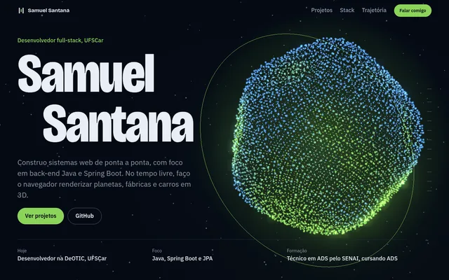
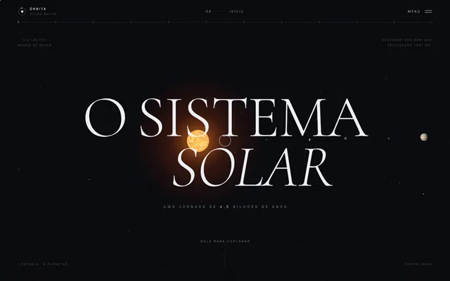
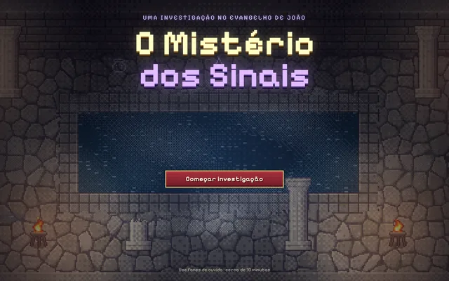
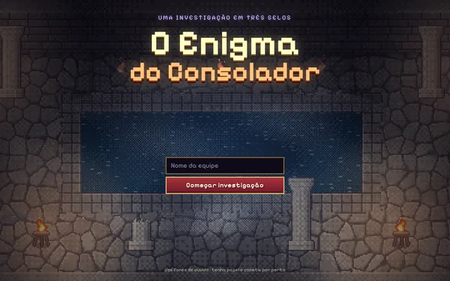
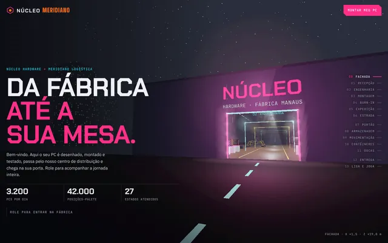
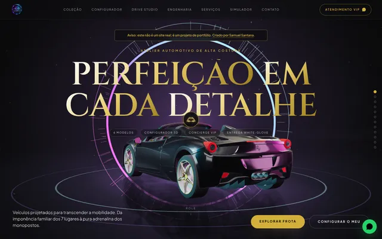
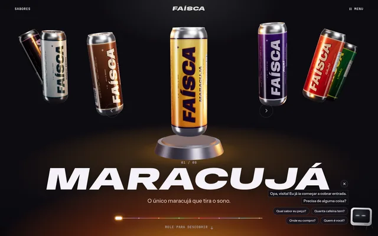
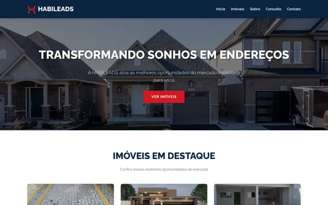

<!-- ============================== CABEÇALHO ============================== -->
<p align="center">
  
</p>

<p align="center">
  <a href="https://sah123campos.github.io/Portfolio_do_Samuel/">
    
  </a>
</p>

<p align="center">
  <a href="https://sah123campos.github.io/Portfolio_do_Samuel/"></a>
  <a href="https://www.linkedin.com/in/samuel-santana-7623402b8/"></a>
  <a href="mailto:samuspcampos@gmail.com"></a>
  <a href="https://wa.me/5519989507788"></a>
</p>

<br>

<!-- ============================== SOBRE MIM ============================== -->
## 👨‍💻 Sobre mim

Construo sistemas web de ponta a ponta, com foco em **back-end Java e Spring Boot**. Comecei fazendo sites para pequenas empresas, passei pelo 3D no navegador e agora estou descendo a pilha até o back-end. No tempo livre, faço o navegador renderizar planetas, fábricas e carros em 3D.

```java
@Component
public class SamuelSantana implements DesenvolvedorFullStack {

    private final String trabalho = "UFSCar · Secretaria Geral de Informática · DeOTIC";
    private final String foco     = "Back-end com Java, Spring Boot e JPA";

    private final List<String> formacao = List.of(
        "Técnico em Análise e Desenvolvimento de Sistemas · SENAI",
        "Graduação em Análise e Desenvolvimento de Sistemas · cursando"
    );

    private final List<String> estudandoAgora = List.of(
        "Spring Security avançado", "Microsserviços com Spring Cloud",
        "AWS", "Docker e Kubernetes"
    );

    @Override
    public String lema() {
        return "Sempre aprendendo, sempre evoluindo.";
    }
}
```

<!-- ============================== TRAJETÓRIA ============================== -->
## 🧭 Trajetória

| Quando | Onde | O que |
|:--:|---|---|
| 🎓 | **SENAI** | Técnico em Análise e Desenvolvimento de Sistemas: lógica, orientação a objetos, banco de dados e arquitetura de sistemas |
| **2025** | **Sites para clientes** | Imobiliária, construtora e empresa de engenharia, do layout à publicação |
| **2026** | **Experiências 3D** | Sistema Solar, Núcleo Meridiano e Aura Motors, com Three.js, shaders e animação guiada pela rolagem |
| **2026** | **UFSCar · DeOTIC** | Desenvolvedor na Universidade Federal de São Carlos, na Secretaria Geral de Informática, atuando no Departamento de Organização e Tratamento da Informação e Conhecimento |
| **Agora** | **Graduação + back-end Java** | Cursando Análise e Desenvolvimento de Sistemas e construindo projetos com Spring Boot |

<!-- ============================== STACK ============================== -->
## 🛠️ Stack

<table align="center">
  <tr>
    <td align="center" width="150"><b>Back-end</b></td>
    <td>
      <br>
      
      
      
    </td>
  </tr>
  <tr>
    <td align="center"><b>Front-end</b></td>
    <td>
      <br>
      
    </td>
  </tr>
  <tr>
    <td align="center"><b>3D e animação</b></td>
    <td>
      <br>
      
      
      
      
    </td>
  </tr>
  <tr>
    <td align="center"><b>Dados</b></td>
    <td></td>
  </tr>
  <tr>
    <td align="center"><b>Ferramentas</b></td>
    <td></td>
  </tr>
</table>

<!-- ============================== PROJETOS ============================== -->
## 🚀 Projetos em destaque

<table>
  <tr>
    <td width="50%" valign="top">
      <a href="https://sah123campos.github.io/Portfolio_do_Samuel/"></a>
      <h3>🌐 Portfólio 3D</h3>
      Meu site pessoal como experiência guiada pela rolagem: um núcleo de 7 mil partículas no centro e as telas dos projetos em órbita.<br><br>
      <code>Three.js</code> <code>WebGL</code> <code>JavaScript</code><br><br>
      <a href="https://sah123campos.github.io/Portfolio_do_Samuel/"><b>▶ Abrir</b></a> · <a href="https://github.com/Sah123campos/Portfolio_do_Samuel">Código</a>
    </td>
    <td width="50%" valign="top">
      <a href="https://sah123campos.github.io/sistema-solar/"></a>
      <h3>🪐 O Sistema Solar</h3>
      Uma viagem pelo Sol e pelos oito planetas, com planetas procedurais em shaders, atmosferas realistas e dados da NASA em escala real.<br><br>
      <code>Three.js</code> <code>GLSL</code> <code>GSAP</code><br><br>
      <a href="https://sah123campos.github.io/sistema-solar/"><b>▶ Fazer a viagem</b></a> · <a href="https://github.com/Sah123campos/sistema-solar">Código</a>
    </td>
  </tr>
  <tr>
    <td width="50%" valign="top">
      <a href="https://sah123campos.github.io/misterio-dos-sinais/"></a>
      <h3>🔍 O Mistério dos Sinais</h3>
      RPG de investigação em pixel art pelos sinais do Evangelho de João: Caná, Poço de Jacó e Betesda. Motor próprio em Canvas, sem engine, e instalável no celular.<br><br>
      <code>JavaScript</code> <code>Canvas</code> <code>PWA</code><br><br>
      <a href="https://sah123campos.github.io/misterio-dos-sinais/"><b>▶ Jogar</b></a> · <a href="https://github.com/Sah123campos/misterio-dos-sinais">Código</a>
    </td>
    <td width="50%" valign="top">
      <a href="https://sah123campos.github.io/enigma-do-consolador/"></a>
      <h3>🗝️ O Enigma do Consolador</h3>
      Jogo de exploração e enigmas para equipes: três selos e pistas escondidas no cenário. As fases são criptografadas no navegador e só abrem com a resposta certa.<br><br>
      <code>JavaScript</code> <code>Canvas</code> <code>Web Crypto</code><br><br>
      <a href="https://sah123campos.github.io/enigma-do-consolador/"><b>▶ Jogar</b></a> · <a href="https://github.com/Sah123campos/enigma-do-consolador">Código</a>
    </td>
  </tr>
  <tr>
    <td width="50%" valign="top">
      <a href="https://sah123campos.github.io/Loja-de-gamers/"></a>
      <h3>🖥️ Núcleo Meridiano</h3>
      Jornada 3D de uma loja de hardware gamer: a rolagem leva a câmera da fábrica de PCs ao armazém e termina no setup do cliente, em primeira pessoa.<br><br>
      <code>Three.js</code> <code>Bloom</code> <code>JavaScript</code><br><br>
      <a href="https://sah123campos.github.io/Loja-de-gamers/"><b>▶ Percorrer a jornada</b></a> · <a href="https://github.com/Sah123campos/Loja-de-gamers">Código</a>
    </td>
    <td width="50%" valign="top">
      <a href="https://sah123campos.github.io/auramotors/"></a>
      <h3>🏎️ Aura Motors</h3>
      Concessionária de luxo fictícia: carro em 3D que acompanha a rolagem, configurador de cores e rodas e catálogo com comparação de modelos.<br><br>
      <code>Three.js</code> <code>Tailwind CSS</code> <code>GLTF</code><br><br>
      <a href="https://sah123campos.github.io/auramotors/"><b>▶ Abrir</b></a> · <a href="https://github.com/Sah123campos/auramotors">Código</a>
    </td>
  </tr>
  <tr>
    <td width="50%" valign="top">
      <a href="https://sah123campos.github.io/faisca/"></a>
      <h3>⚡ Faísca</h3>
      Site conceito de um energético de frutas brasileiras: latas em 3D, tinta líquida e uma assistente de tela.<br><br>
      <code>Three.js</code> <code>JavaScript</code> <code>CSS</code><br><br>
      <a href="https://sah123campos.github.io/faisca/"><b>▶ Abrir</b></a> · <a href="https://github.com/Sah123campos/faisca">Código</a>
    </td>
    <td width="50%" valign="top">
      <a href="https://habileads.com.br/"></a>
      <h3>🏠 Habileads</h3>
      Site de imobiliária no ar: cada empreendimento tem galeria própria e um atalho para conversar com o corretor pelo WhatsApp.<br><br>
      <code>HTML</code> <code>CSS</code> <code>JavaScript</code><br><br>
      <a href="https://habileads.com.br/"><b>▶ Ver site no ar</b></a> · <a href="https://github.com/Sah123campos/Habileads">Código</a>
    </td>
  </tr>
</table>

<details>
  <summary><b>📂 Ver mais projetos</b></summary>
  <br>

| Projeto | O que é | Links |
|---|---|---|
| ☕ **Gestão de Pedidos (E-commerce)** | Back-end em Java feito em equipe na disciplina de Desenvolvimento Back-end | [Código](https://github.com/Sah123campos/ecommerce-pedidos-alfa) |
| ⚔️ **Re:Zero: Uma Jornada** | Site 3D em primeira pessoa por 10 cenários do anime, com modelos e sons gerados por código (projeto de fã) | [Abrir](https://sah123campos.github.io/REZERO3D/) · [Código](https://github.com/Sah123campos/REZERO3D) |
| 🏃 **Neon Rift Parkour 2D** | Parkour procedural em Canvas com modo speedrun, multiplayer e editor de salas | [Jogar](https://sah123campos.github.io/parkour/) · [Código](https://github.com/Sah123campos/parkour) |
| 🏭 **Fábrica Gamer 3D** | A fábrica de PCs do Núcleo Meridiano como página própria, da entrada até a casa do cliente | [Abrir](https://sah123campos.github.io/fabrica-gamer-3d/) · [Código](https://github.com/Sah123campos/fabrica-gamer-3d) |
| 📦 **Armazém 3D** | Caminhada pelo armazém logístico do Núcleo Meridiano, do portão à doca | [Abrir](https://sah123campos.github.io/armazem-3d/) · [Código](https://github.com/Sah123campos/armazem-3d) |
| 🏗️ **Construtora Peixe** | Site institucional com carrossel, contadores animados e galeria de empreendimentos | [Abrir](https://sah123campos.github.io/teste1/) · [Código](https://github.com/Sah123campos/teste1) |
| ⚙️ **Hélio Soluções Engenharia** | Site para engenharia com serviços organizados por norma (NR-11, NR-12, NR-13) | [Abrir](https://sah123campos.github.io/engrenagem_3/) · [Código](https://github.com/Sah123campos/engrenagem_3) |
| 🧮 **Calculadora de Cramer** | Resolve sistemas lineares 2×2, 3×3 e 4×4 mostrando cada determinante | [Usar](https://sah123campos.github.io/cramer/) · [Código](https://github.com/Sah123campos/cramer) |
| 🔑 **Labirinto das Chaves** | Jogo de labirinto no navegador | [Jogar](https://sah123campos.github.io/jogo-das-chaves/) · [Código](https://github.com/Sah123campos/jogo-das-chaves) |
| 📕 **Pokédex Nacional** | Pokédex com os dados e sprites da PokeAPI | [Abrir](https://sah123campos.github.io/pokedex/) · [Código](https://github.com/Sah123campos/pokedex) |
| 🔋 **EnergiaCampus** | Painel de monitoramento energético com simulação de consumo por ambiente | [Abrir](https://sah123campos.github.io/EnergiaCampus/) · [Código](https://github.com/Sah123campos/EnergiaCampus) |
| 🎮 **Daily Games Hub** | Central dos jogos diários dos streamers | [Abrir](https://sah123campos.github.io/daily-games/) · [Código](https://github.com/Sah123campos/daily-games) |

</details>

<!-- ============================== ROADMAP ============================== -->
## 🗺️ Roadmap

- [x] Landing pages e sites responsivos para clientes
- [x] Experiências 3D com Three.js, shaders e animação na rolagem
- [x] Jogos web em pixel art com motor próprio
- [ ] **Gerenciador de Tarefas** com Spring Boot e Thymeleaf · *em desenvolvimento*
- [ ] **API RESTful** com Spring Security e JWT · *planejado*
- [ ] **Microsserviços** com Spring Cloud · *estudando*
- [ ] **Containers em produção** com Docker, Kubernetes e AWS · *estudando*

<!-- ============================== ATIVIDADE ============================== -->
## 🐍 Atividade

<p align="center">
  <picture>
    <source media="(prefers-color-scheme: dark)" srcset="https://raw.githubusercontent.com/Sah123campos/Sah123campos/output/github-snake-dark.svg"/>
    <source media="(prefers-color-scheme: light)" srcset="https://raw.githubusercontent.com/Sah123campos/Sah123campos/output/github-snake.svg"/>
    
  </picture>
</p>

<!-- ============================== CONTATO ============================== -->
## 📫 Contato

Tem um projeto, uma vaga ou uma dúvida sobre algum dos meus trabalhos? Respondo por e-mail ou WhatsApp.

<p align="center">
  <a href="mailto:samuspcampos@gmail.com"></a>
  <a href="https://wa.me/5519989507788"></a>
  <a href="https://www.linkedin.com/in/samuel-santana-7623402b8/"></a>
  <a href="https://www.instagram.com/_samusantana_/"></a>
  <a href="https://sah123campos.github.io/Portfolio_do_Samuel/"></a>
</p>

<p align="center">
  
</p>

<!-- ============================== RODAPÉ ============================== -->
<p align="center">
  
</p>
