<!-- ============================== CABEÇALHO ============================== -->
<p align="center">
  
</p>

<p align="center">
  <a href="https://sah123campos.github.io/Portfolio_do_Samuel/">
    
  </a>
</p>

<p align="center">
  <a href="https://sah123campos.github.io/Portfolio_do_Samuel/"></a>
  <a href="https://www.linkedin.com/in/samuel-santana-7623402b8/"></a>
  <a href="mailto:samuspcampos@gmail.com"></a>
  <a href="https://wa.me/5519989507788"></a>
</p>

<p align="center">
  
  
  
  
</p>

<p align="center">
  <a href="#sobre"><b>Sobre</b></a> ·
  <a href="#stack"><b>Stack</b></a> ·
  <a href="#backend"><b>Back-end</b></a> ·
  <a href="#3d"><b>3D</b></a> ·
  <a href="#jogos"><b>Jogos</b></a> ·
  <a href="#apps"><b>Apps</b></a> ·
  <a href="#clientes"><b>Clientes</b></a> ·
  <a href="#contato"><b>Contato</b></a>
</p>

<br>

<!-- ============================== SOBRE MIM ============================== -->
<a name="sobre"></a>
## 👨‍💻 Sobre mim

Construo sistemas web de ponta a ponta, com foco em **back-end Java e Spring Boot**. Comecei fazendo sites para pequenas empresas, passei pelo 3D no navegador e agora estou descendo a pilha até o back-end. No tempo livre, faço o navegador renderizar planetas, fábricas e carros em 3D, e crio **RPGs em pixel art** com arte desenhada em código e música sintetizada na hora.

```java
@Component
public class SamuelSantana implements DesenvolvedorFullStack {

    private final String trabalho = "UFSCar · Secretaria Geral de Informática · DeOTIC";
    private final String foco     = "Back-end com Java, Spring Boot e JPA";

    private final List<String> formacao = List.of(
        "Técnico em Análise e Desenvolvimento de Sistemas · SENAI",
        "Graduação em Análise e Desenvolvimento de Sistemas · cursando"
    );

    private final List<String> jaFiz = List.of(
        "API REST com Spring Security e JWT", "Sites no ar para clientes",
        "Experiências 3D com shaders", "RPGs completos no navegador", "PWAs que funcionam offline"
    );

    private final List<String> estudandoAgora = List.of(
        "Spring Security avançado", "Microsserviços com Spring Cloud",
        "AWS", "Docker e Kubernetes"
    );

    @Override
    public String lema() {
        return "Sempre aprendendo, sempre evoluindo.";
    }
}
```

<!-- ============================== TRAJETÓRIA ============================== -->
## 🧭 Trajetória

| Quando | Onde | O que |
|:--:|---|---|
| 🎓 | **SENAI** | Técnico em Análise e Desenvolvimento de Sistemas: lógica, orientação a objetos, banco de dados e arquitetura de sistemas |
| **2025** | **Sites para clientes** | Imobiliária, construtora e empresa de engenharia, do layout à publicação |
| **2026** | **Experiências 3D** | Sistema Solar, Núcleo Meridiano e Aura Motors, com Three.js, shaders e animação guiada pela rolagem |
| **2026** | **UFSCar · DeOTIC** | Desenvolvedor na Universidade Federal de São Carlos, na Secretaria Geral de Informática, atuando no DeOTIC |
| **2026** | **Jogos web** | RPGs em pixel art com motor próprio, combate por turnos, enigmas, multiplayer e controles para celular |
| **Agora** | **Graduação + back-end Java** | Cursando Análise e Desenvolvimento de Sistemas e construindo APIs com Spring Boot, Spring Security e JWT |

<!-- ============================== STACK ============================== -->
<a name="stack"></a>
## 🛠️ Stack

<table align="center">
  <tr>
    <td align="center" width="150"><b>Back-end</b></td>
    <td>
      <br>
      
      
      
      
      
    </td>
  </tr>
  <tr>
    <td align="center"><b>Front-end</b></td>
    <td>
      <br>
      
      
      
      
    </td>
  </tr>
  <tr>
    <td align="center"><b>3D, RA e animação</b></td>
    <td>
      <br>
      
      
      
      
    </td>
  </tr>
  <tr>
    <td align="center"><b>Jogos</b></td>
    <td>
      
      
      
      
    </td>
  </tr>
  <tr>
    <td align="center"><b>Dados</b></td>
    <td>
      <br>
      
    </td>
  </tr>
  <tr>
    <td align="center"><b>Ferramentas</b></td>
    <td></td>
  </tr>
</table>

<!-- ============================== BACK-END ============================== -->
<a name="backend"></a>
## ☕ Back-end Java

<table>
  <tr>
    <td width="50%" valign="top">
      <h3>💬 FeedEduc · API de feedback escolar</h3>
      Sistema de feedback anônimo entre alunos e professores. API REST com cadastro de usuários por tipo, feedbacks com status e histórico, respostas e troca de senha.<br><br>
      <code>Spring Boot 3.5</code> <code>Spring Security</code> <code>JWT</code> <code>JPA</code> <code>MySQL</code> <code>Lombok</code><br><br>
      <a href="https://github.com/Sah123campos/concerto-feededuc"><b>▶ Ver código</b></a> · <a href="https://github.com/Sah123campos/Landieduc">Landing page</a>
    </td>
    <td width="50%" valign="top">
      <h3>🛒 Gestão de Pedidos (E-commerce)</h3>
      Back-end em Java feito em equipe na disciplina de Desenvolvimento Back-end: pedidos, produtos e regras de negócio em camadas.<br><br>
      <code>Java</code> <code>Orientação a objetos</code> <code>Trabalho em equipe</code><br><br>
      <a href="https://github.com/Sah123campos/ecommerce-pedidos-alfa"><b>▶ Ver código</b></a>
    </td>
  </tr>
</table>

```text
FeedEduc
├── controller   →  ApiAuthController · FeedbackController · UsuarioController
├── service      →  FeedbackService · UsuarioService · AuthorizationService
├── security     →  SecurityFilter · TokenService (JWT)
├── repository   →  Spring Data JPA
└── model / dto  →  Usuario · Feedback · Resposta · HistoricoFeedback
```

<!-- ============================== 3D ============================== -->
<a name="3d"></a>
## 🌌 Experiências 3D

<table>
  <tr>
    <td width="50%" valign="top">
      <a href="https://sah123campos.github.io/Portfolio_do_Samuel/">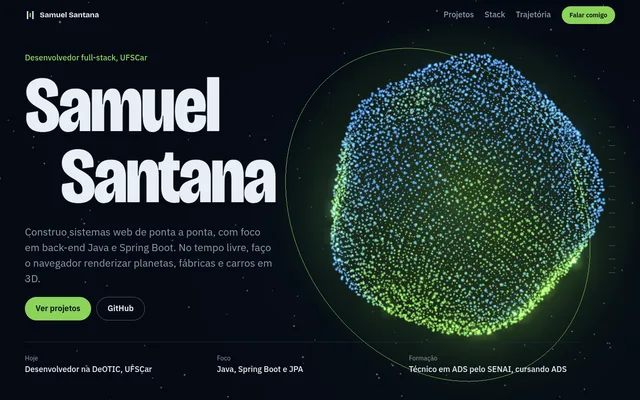</a>
      <h3>🌐 Portfólio 3D</h3>
      Meu site pessoal como experiência guiada pela rolagem: um núcleo de 7 mil partículas no centro e as telas dos projetos em órbita.<br><br>
      <code>Three.js</code> <code>WebGL</code> <code>JavaScript</code><br><br>
      <a href="https://sah123campos.github.io/Portfolio_do_Samuel/"><b>▶ Abrir</b></a> · <a href="https://github.com/Sah123campos/Portfolio_do_Samuel">Código</a>
    </td>
    <td width="50%" valign="top">
      <a href="https://sah123campos.github.io/sistema-solar/">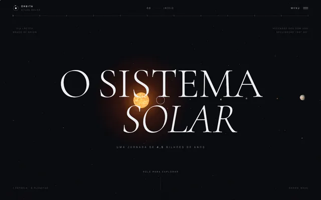</a>
      <h3>🪐 O Sistema Solar</h3>
      Uma viagem pelo Sol e pelos oito planetas, com planetas procedurais em shaders, atmosferas realistas e dados da NASA em escala real.<br><br>
      <code>Three.js</code> <code>GLSL</code> <code>GSAP</code><br><br>
      <a href="https://sah123campos.github.io/sistema-solar/"><b>▶ Fazer a viagem</b></a> · <a href="https://github.com/Sah123campos/sistema-solar">Código</a>
    </td>
  </tr>
  <tr>
    <td width="50%" valign="top">
      <a href="https://sah123campos.github.io/Loja-de-gamers/">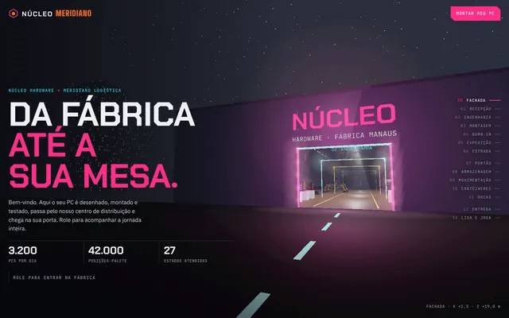</a>
      <h3>🖥️ Núcleo Meridiano</h3>
      Jornada 3D de uma loja de hardware gamer: a rolagem leva a câmera da fábrica de PCs ao armazém e termina no setup do cliente, em primeira pessoa.<br><br>
      <code>Three.js</code> <code>Bloom</code> <code>JavaScript</code><br><br>
      <a href="https://sah123campos.github.io/Loja-de-gamers/"><b>▶ Percorrer a jornada</b></a> · <a href="https://github.com/Sah123campos/Loja-de-gamers">Código</a>
    </td>
    <td width="50%" valign="top">
      <a href="https://sah123campos.github.io/auramotors/"></a>
      <h3>🏎️ Aura Motors</h3>
      Concessionária de luxo fictícia: carro em 3D que acompanha a rolagem, configurador de cores e rodas e catálogo com comparação de modelos.<br><br>
      <code>Three.js</code> <code>Tailwind CSS</code> <code>GLTF</code><br><br>
      <a href="https://sah123campos.github.io/auramotors/"><b>▶ Abrir</b></a> · <a href="https://github.com/Sah123campos/auramotors">Código</a>
    </td>
  </tr>
  <tr>
    <td width="50%" valign="top">
      <a href="https://sah123campos.github.io/faisca/">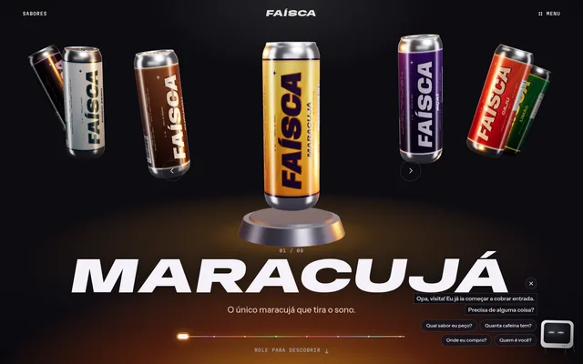</a>
      <h3>⚡ Faísca</h3>
      Site conceito de um energético de frutas brasileiras: latas em 3D, tinta líquida e uma assistente de tela.<br><br>
      <code>Three.js</code> <code>JavaScript</code> <code>CSS</code><br><br>
      <a href="https://sah123campos.github.io/faisca/"><b>▶ Abrir</b></a> · <a href="https://github.com/Sah123campos/faisca">Código</a>
    </td>
    <td width="50%" valign="top">
      <h3>⚔️ Re:Zero: Uma Jornada</h3>
      Site 3D em primeira pessoa por 10 cenários do anime, com modelos e sons gerados por código (projeto de fã).<br><br>
      <code>Three.js</code> <code>Web Audio</code><br><br>
      <a href="https://sah123campos.github.io/REZERO3D/"><b>▶ Abrir</b></a> · <a href="https://github.com/Sah123campos/REZERO3D">Código</a>
      <br><br>
      <h3>🏭 Fábrica Gamer 3D · 📦 Armazém 3D</h3>
      As cenas do Núcleo Meridiano como páginas próprias: a fábrica de PCs e a caminhada pelo armazém, do portão à doca.<br><br>
      <a href="https://sah123campos.github.io/fabrica-gamer-3d/"><b>▶ Fábrica</b></a> · <a href="https://sah123campos.github.io/armazem-3d/"><b>▶ Armazém</b></a>
    </td>
  </tr>
</table>

<!-- ============================== JOGOS ============================== -->
<a name="jogos"></a>
## 🎮 Jogos web

Todos rodam no navegador, no computador e no celular, sem instalar nada. Arte desenhada em código, música sintetizada na hora e motor próprio.

<table>
  <tr>
    <td width="50%" valign="top">
      <h3>🕯️ Vagalume</h3>
      RPG narrativo com <b>24 mapas</b>, batalhas por turnos em que as <b>emoções</b> mudam a estratégia, 16 inimigos, 4 chefes com mecânica própria, 12 combos, 10 missões e 3 espaços de save. Tudo original, sem nenhuma imagem ou biblioteca externa.<br><br>
      <code>JavaScript</code> <code>Canvas</code> <code>Web Audio</code> <code>Testes</code><br><br>
      <a href="https://sah123campos.github.io/vagalume/"><b>▶ Jogar</b></a> · <a href="https://github.com/Sah123campos/vagalume">Código</a>
    </td>
    <td width="50%" valign="top">
      <h3>🌾 Despertar em Aethermoor</h3>
      Mundo aberto de fazenda, construção e RPG: 6 biomas, estações e clima, 5 masmorras com chefes, <b>cooperativo para até 8 jogadores</b> e o Doidobot, um assistente que conversa com <b>IA</b> (Ollama/DeepSeek, Claude ou Gemini).<br><br>
      <code>JavaScript</code> <code>Node.js</code> <code>WebSocket</code> <code>IA</code><br><br>
      <a href="https://sah123campos.github.io/aethermoor/"><b>▶ Jogar</b></a> · <a href="https://github.com/Sah123campos/aethermoor">Código</a>
    </td>
  </tr>
  <tr>
    <td width="50%" valign="top">
      <h3>👁️ Ecos da Pessoa Esquecida</h3>
      Exploração, enigmas e terror psicológico em pixel art, com sete capítulos e cinco finais. Luz negra, furtividade, diário e mapa.<br><br>
      <code>JavaScript</code> <code>Canvas</code> <code>Pixel art</code><br><br>
      <a href="https://sah123campos.github.io/ecos-da-pessoa-esquecida/"><b>▶ Jogar</b></a> · <a href="https://github.com/Sah123campos/ecos-da-pessoa-esquecida">Código</a>
    </td>
    <td width="50%" valign="top">
      <h3>🌱 Raízes do Sertão</h3>
      Fazenda sustentável no sertão: 12 culturas, cisterna e estiagem, composteira, mandala agrícola e o Sisteminha da Embrapa, com textos que separam "no jogo" de "na vida real". Instala como app (PWA).<br><br>
      <code>JavaScript</code> <code>PWA</code> <code>Service Worker</code><br><br>
      <a href="https://sah123campos.github.io/verdejar/"><b>▶ Jogar</b></a> · <a href="https://github.com/Sah123campos/verdejar">Código</a>
    </td>
  </tr>
  <tr>
    <td width="50%" valign="top">
      <a href="https://sah123campos.github.io/enigma-do-consolador/">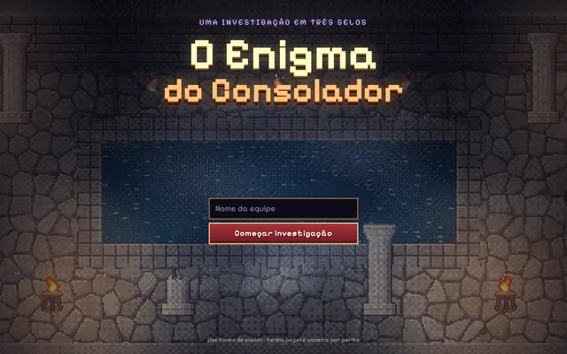</a>
      <h3>🔐 O Enigma do Consolador</h3>
      RPG de enigmas para equipes em três selos (João 14–16, Atos 1 e 2). As fases ficam criptografadas para ninguém pular etapas.<br><br>
      <a href="https://sah123campos.github.io/enigma-do-consolador/"><b>▶ Jogar</b></a> · <a href="https://github.com/Sah123campos/enigma-do-consolador">Código</a>
    </td>
    <td width="50%" valign="top">
      <a href="https://sah123campos.github.io/misterio-dos-sinais/">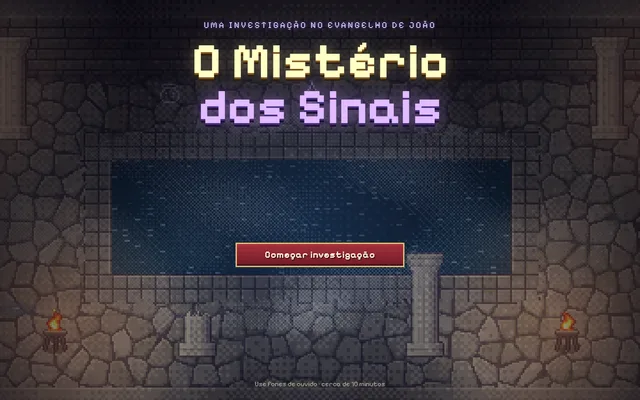</a>
      <h3>🍷 O Mistério dos Sinais</h3>
      Suspense e investigação pelos sinais do Evangelho de João: Caná, o Poço de Jacó e o Tanque de Betesda, em cerca de 10 minutos.<br><br>
      <a href="https://sah123campos.github.io/misterio-dos-sinais/"><b>▶ Jogar</b></a> · <a href="https://github.com/Sah123campos/misterio-dos-sinais">Código</a>
    </td>
  </tr>
  <tr>
    <td width="50%" valign="top">
      <a href="https://sah123campos.github.io/parkour/">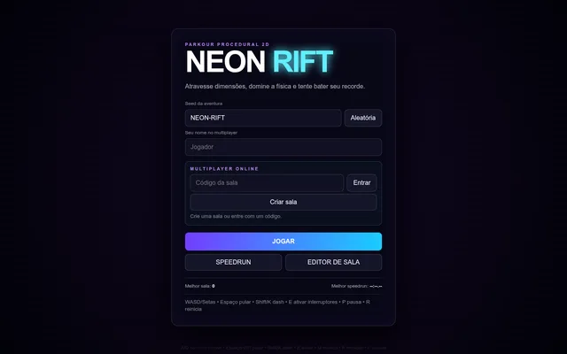</a>
      <h3>🏃 Neon Rift Parkour 2D</h3>
      Parkour procedural em Canvas com modo speedrun, multiplayer e editor de salas.<br><br>
      <a href="https://sah123campos.github.io/parkour/"><b>▶ Jogar</b></a> · <a href="https://github.com/Sah123campos/parkour">Código</a>
    </td>
    <td width="50%" valign="top">
      <h3>⭐ Estrelas da Fazenda · 🎬 Mistério no Tapete Vermelho</h3>
      Dois RPGs de acampamento no mesmo motor: você cria o personagem com <b>a foto do seu rosto</b>, monta o look no camarim e conversa com todo mundo para descobrir o tema secreto.<br><br>
      <a href="https://sah123campos.github.io/estrelas-da-chacara/"><b>▶ Estrelas</b></a> · <a href="https://sah123campos.github.io/misterio/"><b>▶ Tapete Vermelho</b></a>
      <br><br>
      <h3>❤️ O Maior Amor</h3>
      Jogo curto de cerca de 2 minutos sobre João 15:13.<br><br>
      <a href="https://sah123campos.github.io/quem-e-ele/"><b>▶ Jogar</b></a> · <a href="https://github.com/Sah123campos/quem-e-ele">Código</a>
    </td>
  </tr>
</table>

<!-- ============================== APPS ============================== -->
<a name="apps"></a>
## 🧰 Apps e ferramentas

<table>
  <tr>
    <td width="50%" valign="top">
      <h3>📊 Painel Finanças</h3>
      Gestão financeira, planilhas e dashboards no estilo Power BI e Excel, tudo no navegador e sem conta. Importa XLSX, CSV e JSON, tem <b>23 tipos de gráfico</b>, orçamentos com alerta, metas, recorrências e compartilhamento por link.<br><br>
      <code>React</code> <code>TypeScript</code> <code>Vite</code> <code>ECharts</code> <code>Dexie</code> <code>Zod</code> <code>Vitest</code><br><br>
      <a href="https://sah123campos.github.io/Financas/"><b>▶ Abrir</b></a> · <a href="https://github.com/Sah123campos/Financas">Código</a>
    </td>
    <td width="50%" valign="top">
      <h3>🏭 HCNC Antimistura</h3>
      Controle contra mistura de peças para linha de produção: lê pela câmera a folha do carro e o código da peça e mostra <b>OK</b> ou <b>NOK</b> com som. Funciona sem internet depois de instalado.<br><br>
      <code>JavaScript</code> <code>PWA</code> <code>Câmera</code> <code>Offline</code><br><br>
      <a href="https://sah123campos.github.io/hcnc-antimistura/"><b>▶ Abrir</b></a> · <a href="https://github.com/Sah123campos/hcnc-antimistura">Código</a>
    </td>
  </tr>
  <tr>
    <td width="50%" valign="top">
      <a href="https://sah123campos.github.io/cramer/">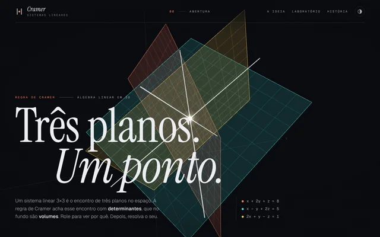</a>
      <h3>🧮 Calculadora de Cramer</h3>
      Resolve sistemas lineares 2×2, 3×3 e 4×4 mostrando cada determinante.<br><br>
      <a href="https://sah123campos.github.io/cramer/"><b>▶ Usar</b></a> · <a href="https://github.com/Sah123campos/cramer">Código</a>
    </td>
    <td width="50%" valign="top">
      <h3>🥽 Manual do Torno CNC em RA</h3>
      Manual interativo de torno CNC em realidade aumentada: aponte a câmera e as peças aparecem em 3D.<br><br>
      <code>A-Frame</code> <code>MindAR</code> <code>GLB</code><br><br>
      <a href="https://github.com/Sah123campos/AULACNC"><b>▶ Ver código</b></a> · <a href="https://github.com/Sah123campos/Realidade-Aumentada">Outro teste de RA</a>
      <br><br>
      <h3>🔋 EnergiaCampus</h3>
      Painel de monitoramento energético com simulação de consumo por ambiente.<br><br>
      <a href="https://sah123campos.github.io/EnergiaCampus/"><b>▶ Abrir</b></a> · <a href="https://github.com/Sah123campos/EnergiaCampus">Código</a>
    </td>
  </tr>
</table>

<!-- ============================== CLIENTES ============================== -->
<a name="clientes"></a>
## 🏢 Sites para clientes

<table>
  <tr>
    <td width="33%" valign="top">
      <a href="https://habileads.com.br/">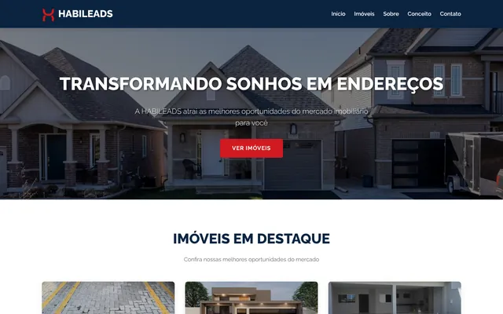</a>
      <b>🏠 Habileads</b><br>
      Imobiliária no ar: galeria por empreendimento e atalho para o corretor no WhatsApp.<br>
      <a href="https://habileads.com.br/"><b>▶ Site no ar</b></a> · <a href="https://github.com/Sah123campos/Habileads">Código</a>
    </td>
    <td width="33%" valign="top">
      <a href="https://sah123campos.github.io/teste1/">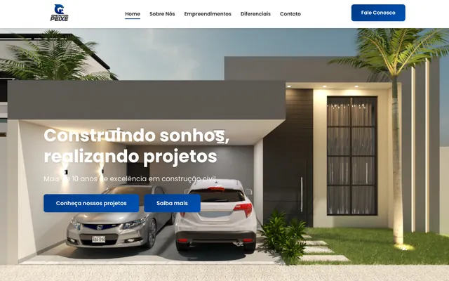</a>
      <b>🏗️ Construtora Peixe</b><br>
      Site institucional com carrossel, contadores animados e galeria de obras.<br>
      <a href="https://sah123campos.github.io/teste1/"><b>▶ Abrir</b></a> · <a href="https://github.com/Sah123campos/teste1">Código</a>
    </td>
    <td width="33%" valign="top">
      <a href="https://sah123campos.github.io/engrenagem_3/">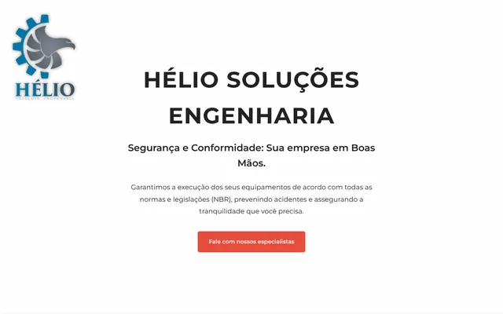</a>
      <b>⚙️ Hélio Soluções</b><br>
      Engenharia com serviços organizados por norma (NR-11, NR-12, NR-13).<br>
      <a href="https://sah123campos.github.io/engrenagem_3/"><b>▶ Abrir</b></a> · <a href="https://github.com/Sah123campos/engrenagem_3">Código</a>
    </td>
  </tr>
</table>

<details>
  <summary><b>📂 Ver mais projetos</b></summary>
  <br>

| Projeto | O que é | Links |
|---|---|---|
| 🔫 **CS Lite Evoluído** | FPS no navegador com espada, ondas de inimigos e upgrades, com placar no Firebase | [Código](https://github.com/Sah123campos/cs) |
| 🔑 **Labirinto das Chaves** | Jogo de labirinto no navegador | [Jogar](https://sah123campos.github.io/jogo-das-chaves/) · [Código](https://github.com/Sah123campos/jogo-das-chaves) |
| 📕 **Pokédex Nacional** | Pokédex com os dados e sprites da PokeAPI | [Abrir](https://sah123campos.github.io/pokedex/) · [Código](https://github.com/Sah123campos/pokedex) |
| 📖 **Grimório de Re:Zero** | Enciclopédia de fã sobre o universo do anime | [Código](https://github.com/Sah123campos/rezero) |
| 🎮 **Daily Games Hub** | Central dos jogos diários dos streamers | [Abrir](https://sah123campos.github.io/daily-games/) · [Código](https://github.com/Sah123campos/daily-games) |
| 📈 **TechMob 4.0 · OEE Monitor** | Dashboard de eficiência de máquinas (OEE) para a indústria | [Código](https://github.com/Sah123campos/Dashboard-com-cores-bonitas) |
| ☁️ **Provedores de Nuvem** | Comparativo de AWS, Azure e GCP feito nos estudos de Docker | [Código](https://github.com/Sah123campos/estudodocker) |
| 🧠 **Neuroinclusão** | App em React Native sobre neurodiversidade e inclusão de PCDs no trabalho | [Código](https://github.com/Sah123campos/PDM) |
| 📱 **Guia de Celulares** | Comparativo para escolher celular com clareza | [Código](https://github.com/Sah123campos/Celular) |
| 🏅 **Sistema de Classificação** | Tabela de classificação de competição | [Código](https://github.com/Sah123campos/classificacao) |
| 🌿 **Iza · Psicologia** | Site para consultório de psicologia | [Código](https://github.com/Sah123campos/psicologia) |
| ⛪ **Sites para igrejas** | AD Brás São Carlos, EMU São Carlos e Comunhão e Harmonia | [AD Brás](https://github.com/Sah123campos/adbrassaocarlos) · [EMU](https://github.com/Sah123campos/emusaocarlos) · [Comunhão](https://github.com/Sah123campos/VemDemarqui) |
| ⏱️ **Componentes JS** | Relógio digital, contador, título dinâmico e aviso com temporizador | [Relógio](https://github.com/Sah123campos/relogiodigital) · [Contador](https://github.com/Sah123campos/contador) · [Aviso](https://github.com/Sah123campos/Componente-de-Aviso-com-Temporizador) |

</details>

<!-- ============================== ROADMAP ============================== -->
## 🗺️ Roadmap

- [x] Landing pages e sites responsivos para clientes
- [x] Experiências 3D com Three.js, shaders e animação na rolagem
- [x] **API REST** com Spring Boot, Spring Security e JWT · [FeedEduc](https://github.com/Sah123campos/concerto-feededuc)
- [x] RPGs completos no navegador, com multiplayer e PWA offline
- [x] Dashboards com React, TypeScript e testes automatizados · [Painel Finanças](https://github.com/Sah123campos/Financas)
- [ ] **Gerenciador de Tarefas** com Spring Boot e Thymeleaf · *em desenvolvimento*
- [ ] **Microsserviços** com Spring Cloud · *estudando*
- [ ] **Containers em produção** com Docker, Kubernetes e AWS · *estudando*

<!-- ============================== ATIVIDADE ============================== -->
## 🐍 Atividade

<p align="center">
  <picture>
    <source media="(prefers-color-scheme: dark)" srcset="https://raw.githubusercontent.com/Sah123campos/Sah123campos/output/github-snake-dark.svg"/>
    <source media="(prefers-color-scheme: light)" srcset="https://raw.githubusercontent.com/Sah123campos/Sah123campos/output/github-snake.svg"/>
    
  </picture>
</p>

<!-- ============================== CONTATO ============================== -->
<a name="contato"></a>
## 📫 Contato

Tem um projeto, uma vaga ou uma dúvida sobre algum dos meus trabalhos? Respondo por e-mail ou WhatsApp.

<p align="center">
  <a href="mailto:samuspcampos@gmail.com"></a>
  <a href="https://wa.me/5519989507788"></a>
  <a href="https://www.linkedin.com/in/samuel-santana-7623402b8/"></a>
  <a href="https://www.instagram.com/_samusantana_/"></a>
  <a href="https://sah123campos.github.io/Portfolio_do_Samuel/"></a>
</p>

<p align="center">
  
</p>

<!-- ============================== RODAPÉ ============================== -->
<p align="center">
  
</p>
